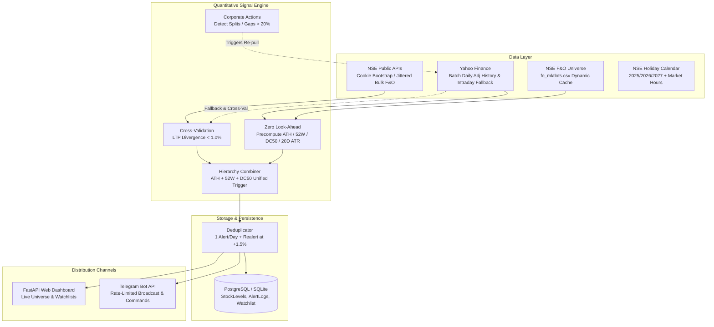

# Institutional Real-Time Breakout Screener | Indian Equities (NSE F&O)

An institutional-grade, real-time quantitative breakout detection system engineered specifically for Indian equities (all ~185+ NSE F&O stocks). The engine monitors the market in real time during official NSE hours (09:15–15:30 IST), precomputes key historical levels without look-ahead bias, evaluates price action against strict statistical filters, cross-validates quotes between independent data feeds, and dispatches rich automated alerts via Telegram and a live web dashboard.

---

## 🏛️ System Architecture



---

## 🎯 Signal Logic & Definitions (Separate Buy & Sell Side Alerts)

All alerts are evaluated and dispatched **separately**. Each condition triggers its own dedicated, concise 3-line alert for both **BUY** (Long Breakout) and **SELL** (Short Breakdown) sides:

| Trigger Code | Condition / Description | Side | Level Evaluated |
| :--- | :--- | :--- | :--- |
| **`ATH`** | All-Time High breakout | **BUY** | $\text{Price} > \text{ATH High}$ |
| **`52W_HIGH`** | 52-Week High breakout (252D) | **BUY** | $\text{Price} > \text{52W High}$ |
| **`DC50_HIGH`** | Donchian 50 High breakout | **BUY** | $\text{Price} > \text{DC50 High}$ |
| **`DC20_HIGH`** | Donchian 20 High breakout | **BUY** | $\text{Price} > \text{DC20 High}$ |
| **`ST_15M_10_1_BUY`** | Supertrend (10,1) 15-min Bullish flip | **BUY** | $\text{Price} > \text{ST}_{15m}(10,1)$ |
| **`ST_15M_10_2_BUY`** | Supertrend (10,2) 15-min Bullish flip | **BUY** | $\text{Price} > \text{ST}_{15m}(10,2)$ |
| **`ST_DAILY_10_1_BUY`** | Supertrend (10,1) Daily Bullish flip | **BUY** | $\text{Price} > \text{ST}_{\text{Daily}}(10,1)$ |
| **`ST_DAILY_10_2_BUY`** | Supertrend (10,2) Daily Bullish flip | **BUY** | $\text{Price} > \text{ST}_{\text{Daily}}(10,2)$ |
| **`ATL`** | All-Time Low breakdown | **SELL** | $\text{Price} < \text{ATL Low}$ |
| **`52W_LOW`** | 52-Week Low breakdown (252D) | **SELL** | $\text{Price} < \text{52W Low}$ |
| **`DC50_LOW`** | Donchian 50 Low breakdown | **SELL** | $\text{Price} < \text{DC50 Low}$ |
| **`DC20_LOW`** | Donchian 20 Low breakdown | **SELL** | $\text{Price} < \text{DC20 Low}$ |
| **`ST_15M_10_1_SELL`** | Supertrend (10,1) 15-min Bearish flip | **SELL** | $\text{Price} < \text{ST}_{15m}(10,1)$ |
| **`ST_15M_10_2_SELL`** | Supertrend (10,2) 15-min Bearish flip | **SELL** | $\text{Price} < \text{ST}_{15m}(10,2)$ |
| **`ST_DAILY_10_1_SELL`** | Supertrend (10,1) Daily Bearish flip | **SELL** | $\text{Price} < \text{ST}_{\text{Daily}}(10,1)$ |
| **`ST_DAILY_10_2_SELL`** | Supertrend (10,2) Daily Bearish flip | **SELL** | $\text{Price} < \text{ST}_{\text{Daily}}(10,2)$ |

### Signal Hierarchy (Unified Alerts)
If a stock triggers an **ATH**, it inherently breaks its 52-Week High and Donchian 50. Rather than spamming three fragmented alerts, the engine consolidates them into **one unified alert**:
- **Tier 1:** `ATH + 52W + DC50` (Highest priority)
- **Tier 2:** `52W + DC50`
- **Tier 3:** `DC50`

### Quantitative Filters
Configured via `config/config.yaml`:
- **Price Range:** ₹20.00 to ₹150,000 (excludes penny stocks).
- **Minimum 20D Average Volume:** 50,000 shares.
- **Minimum Turnover:** ₹5.00 Crore daily turnover.
- **Relative Volume (RVOL):** Compares current cumulative volume to 20D average volume.
- **Clearance Tolerance:** Must clear level by at least $+0.05\%$, but must not exceed $+3.5\%$ (prevents chasing runaway gap-ups).
- **Trigger Modes:**
  - `ltp_above` (Default): Last Traded Price is strictly above the level.
  - `intraday_touch`: Intraday High touches or exceeds level.
  - `candle_close`: End-of-day confirmation at market close.

---

## 🛡️ Reliability & Institutional Safeguards

1. **Exchange Session Management:**
   - Emulates browser headers, TLS characteristics, and randomized request jitter.
   - Bootstraps session cookies from the NSE homepage, auto-refreshing on HTTP 401/403.
   - High-throughput bulk polling (`SECURITIES IN F&O` index) reduces 200 API calls to a single call per cycle.
2. **Graceful Fallback & Circuit Breaker:**
   - If NSE public endpoints fail or trip the circuit breaker (5 consecutive errors), the system falls back automatically to Yahoo Finance 1m/5m intraday bars.
3. **Cross-Validation (Bad Tick Rejection):**
   - Live prices are cross-validated between NSE and Yahoo. If divergence $> 1.0\%$, the alert is flagged as suspicious and held until feeds align.
4. **Corporate Action Discontinuity Detection:**
   - Detects unadjusted splits/bonus issues ($>20\%$ gap) and triggers an immediate historical re-pull for that symbol.
5. **Survives Process Restarts:**
   - Levels and alerts are persisted in PostgreSQL/SQLite. Today's alerts are re-warmed into memory on boot.

---

## 📱 Telegram Alerting & Commands

### Sample Real-Time Telegram Alerts (3-Line Ultra-Short Format)

**BUY Alert (e.g. DC20 Breakout):**
```html
⚡ <b>TRENT</b> | <b>DC20 BREAKOUT</b> (+1.8%)
LTP: <b>₹3,150.00</b> | Level: <b>₹3,120.00</b> (+1.0%)
Trigger: <b>BUY (DC20 BREAKOUT)</b> | RVOL: <b>2.1x</b> | <i>10:15 IST</i>
```

**BUY Alert (e.g. ST 15m 10,1):**
```html
🟢 <b>TATAMOTORS</b> | <b>ST 15m (10,1) BUY</b> (+1.5%)
LTP: <b>₹985.40</b> | Level: <b>₹975.20</b> (+1.0%)
Trigger: <b>BUY (ST 15m (10,1) BUY)</b> | RVOL: <b>1.7x</b> | <i>09:45 IST</i>
```

**SELL Alert (e.g. 52W Low Breakdown):**
```html
🔻 <b>INFY</b> | <b>52W LOW BREAKDOWN</b> (-2.8%)
LTP: <b>₹1,380.00</b> | Level: <b>₹1,395.00</b> (-1.1%)
Trigger: <b>SELL (52W LOW BREAKDOWN)</b> | RVOL: <b>2.4x</b> | <i>13:10 IST</i>
```

**SELL Alert (e.g. ST Daily 10,2):**
```html
🔴 <b>SBIN</b> | <b>ST DAILY (10,2) SELL</b> (-1.4%)
LTP: <b>₹815.00</b> | Level: <b>₹824.00</b> (-1.1%)
Trigger: <b>SELL (ST DAILY (10,2) SELL)</b> | RVOL: <b>1.9x</b> | <i>11:30 IST</i>
```

### Scheduled Operational Reports
- **09:10 IST Pre-Market Watchlist:** Summarizes stocks within $1.0\%$ of ATH, 52W, or DC50 levels.
- **15:45 IST End-Of-Day Report:** Full summary of all breakouts triggered during the session, with **close confirmation status** (whether the stock closed above the level or retraced).
- **Heartbeat & Admin Alerts:** Dispatched every 15 minutes or immediately upon error to the dedicated `ADMIN_CHAT_ID`.

### Interactive Bot Commands
Authorized users (whitelisted chat IDs) can interact with the bot:
- `/status` — View system state, market open status, tracked universe, scan latency.
- `/today` — View list of all breakouts triggered today.
- `/levels SYMBOL` — Inspect precomputed ATH, 52W, and DC50 levels for any stock (e.g. `/levels RELIANCE`).
- `/watch SYMBOL` — Add stock to custom watchlist.
- `/unwatch SYMBOL` — Remove stock from custom watchlist.
- `/pause` — Temporarily halt alert broadcasting.
- `/resume` — Resume alert broadcasting.

---

## 💻 Web Dashboard

A responsive dashboard built with FastAPI, Tailwind CSS, and Alpine.js (zero node_modules build step required).

Features:
- **Live Breakouts Tab:** Real-time table of stocks that have broken out today.
- **Near-Breakout Watchlist:** Stocks hovering within $1\%$ of critical levels.
- **All F&O Universe:** Interactive table of all ~185 F&O stocks with real-time distance to ATH, 52W, DC50, RVOL, and % change.
- **Alert Log:** Audit trail of all dispatched Telegram messages.
- **Health & Admin Controls:** Scan duration monitoring, pause/resume toggles.
- Access via: `http://localhost:8000/`

---

## 🚀 Step-by-Step Deployment Guide

### Step 1: Telegram Bot Setup
1. Open Telegram, search for `@BotFather`, and send `/newbot`.
2. Follow the prompts to name your bot and receive your **HTTP API Token** (e.g. `7123456789:ABCDefG...`).
3. To obtain your personal Chat ID:
   - Search for `@userinfobot` on Telegram and send `/start`. It will print your `Id`.
4. To obtain a Group or Channel ID:
   - Add your bot as an administrator to the group/channel.
   - Forward a message from the channel to `@userinfobot` or check via `https://api.telegram.org/bot<TOKEN>/getUpdates`. Channel IDs start with `-100`.

### Step 2: Local Setup & Running Tests
```bash
# Clone and enter directory
cd SAHIDBHAI

# Create virtual environment
python -m venv venv
source venv/bin/activate  # On Windows: venv\Scripts\activate

# Install dependencies
pip install -r requirements.txt

# Run complete test suite (zero look-ahead, corporate actions, cross-val, deduplication, integration)
pytest -v

# Run historical replay backtester on RELIANCE
python -m backtest.replay --symbol RELIANCE --days 500

# Start local server with web dashboard
uvicorn main:app --host 0.0.0.0 --port 8000 --reload
```

### Step 3: Production Deployment on Render
The repository includes a ready-to-deploy **Render Blueprint** (`render.yaml`).

1. Push your repository to GitHub or GitLab.
2. Log into [Render Dashboard](https://dashboard.render.com).
3. Click **New +** -> **Blueprint**.
4. Select your repository. Render will automatically detect `render.yaml` and provision:
   - **PostgreSQL Database:** `nse-screener-db`
   - **Web Service:** `nse-screener-web` (FastAPI dashboard & JSON API)
   - **Background Worker:** `nse-screener-worker` (Async real-time scanning loop)
5. Fill in the required environment variables:
   - `TELEGRAM_BOT_TOKEN`: Your token from @BotFather.
   - `TELEGRAM_CHAT_IDS`: Comma-separated chat/channel IDs (e.g. `-100123456789,987654321`).
   - `ADMIN_CHAT_ID`: Your personal Telegram ID for system notifications.
   - `DASHBOARD_TOKEN`: Secure secret token for dashboard API authentication.
6. Click **Apply**. Render will build and deploy the entire architecture.

> [!NOTE]
> **Free Tier Sleep Note & Keep-Alive Strategy:**
> Render's free web services spin down after 15 minutes of inactivity. For continuous institutional operation, we configure the **Starter** worker plan in `render.yaml`. If utilizing the free tier for the web service, set up a free monitor on [UptimeRobot](https://uptimerobot.com) pinging `https://<your-render-app>.onrender.com/api/health` every 5 minutes.

---

## 🔬 Historical Replay Backtester

Validate the breakout logic across historical market regimes:
```bash
python -m backtest.replay --symbol TCS --days 750
```
Output:
```text
===========================================================================
REPLAY RESULTS: TCS (Last 750 trading days)
===========================================================================
Total Breakout Signals Detected: 14

Date         Triggers           Level      Close      % Above   RVOL   5D Ret    10D Ret  
----------------------------------------------------------------------------------------
2023-07-14   DC50               ₹3,450.00  ₹3,514.90  +1.88%    2.4x   +2.15%    +3.40%   
2023-11-28   52W + DC50         ₹3,580.00  ₹3,620.00  +1.12%    1.9x   +1.80%    +4.25%   
2024-01-12   ATH + 52W + DC50   ₹3,928.00  ₹3,960.00  +0.81%    3.1x   +4.10%    +6.20%   

5-Day Win Rate: 78.6% | Avg 5-Day Return: +2.42%
```

---

## ⚠️ Known Limitations & Institutional Upgrades

While this screener is fully automated and robust, developers deploying at proprietary trading desks should note:

1. **Exchange Public Endpoint Volatility:**
   NSE web endpoints occasionally rotate headers or rate limits. The built-in cookie bootstrapping and fallback to Yahoo Finance mitigate this.
2. **Yahoo Intraday Data Latency:**
   Yahoo Finance 1m/5m intraday bars can carry a 1–3 minute delay during peak volatility.
3. **Institutional WebSocket Upgrade Path:**
   For sub-second tick-level execution, the data layer (`data/nse_client.py`) can be seamlessly swapped with commercial broker WebSockets:
   - **Zerodha Kite Connect WebSocket** (`kiteconnect.Ticker`)
   - **DhanHQ Live Market Feed WebSocket**
   - **Upstox Market Data Feed v2**
   - **Direct NSE TBT (Tick-By-Tick) Normalized Multicast Feed** (via TCP/UDP socket adapter)

---

## 📜 License
MIT License. Built for professional quantitative developers and traders.
